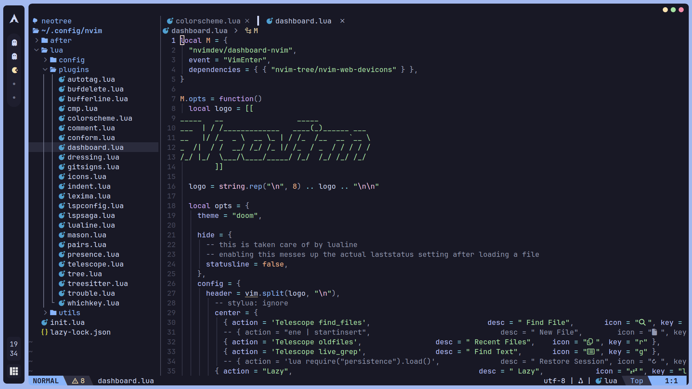

# neovim-config

My personal neovim configuration, written in Lua.

## Features

- Fast startup with lazy-loaded plugins (lazy.nvim)
- LSP, autocompletions, formatter out of the box
- Fuzzy Finders (telescope)
- File Explorer (neo-tree)
- Colorscheme (catppuccin)
- Git integrations (gitsigns)
- Discord Presence
- Key Binds Helper (whichkey)
